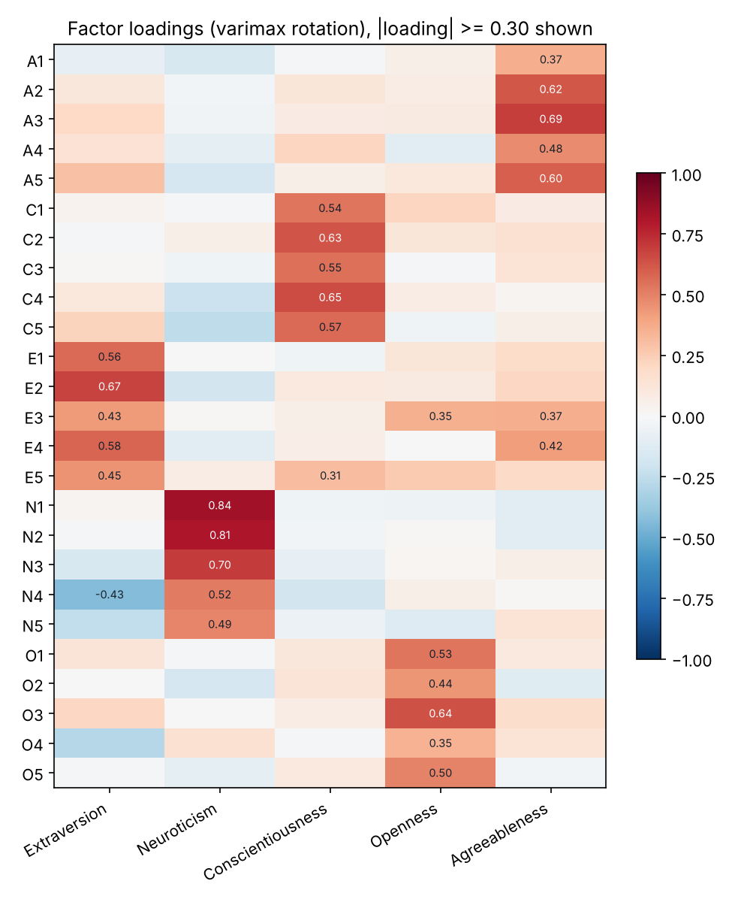

# Big Five Psychometrics

A Python analysis of a real personality survey: 2,800 people answering the
25-item Big Five Inventory from the SAPA project. It checks whether the
questionnaire measures what it claims to, the way a psychometrician would:
scoring with reverse-keyed items, reliability, factor structure, and group
differences reported with effect sizes.



## Findings

- **Reliability.** Cronbach's alpha is 0.70 (Agreeableness), 0.73
  (Conscientiousness), 0.76 (Extraversion), 0.81 (Neuroticism) and 0.60
  (Openness). These match the values published for this dataset, and the tests
  check that they keep matching. Openness falls below the usual 0.70 threshold,
  and item O4 ("Spend time reflecting on things") is its weakest item.
- **Structure.** The data is clearly factorable (KMO = 0.85, Bartlett's
  p < .001), five eigenvalues exceed 1, and **all 25 items load most strongly on
  their intended trait** in a five-factor model.
- **Gender.** Women score higher on Agreeableness (d = 0.45), Neuroticism
  (0.27), Extraversion (0.23) and Conscientiousness (0.20), and slightly lower
  on Openness (−0.12). All survive Holm correction; most are small effects.
- **Age.** Agreeableness (r = .19) and Conscientiousness (r = .12) rise with
  age and Neuroticism falls (r = −.12), in line with research on personality
  maturation.

Full tables are in [reports/report.md](reports/report.md).

## What it does

| Step | Method |
| --- | --- |
| Cleaning | Rejects out-of-range answers and implausible ages (2 rows had ages under 11) |
| Scoring | Reverse-keys 7 items with (min + max − x); trait score = mean of items, needs ≥ 3 answered |
| Reliability | Cronbach's alpha, corrected item–rest correlations, alpha-if-item-dropped |
| Factorability | KMO and Bartlett's test of sphericity, implemented from their formulas |
| Structure | Maximum-likelihood factor analysis, varimax rotation, item-to-trait match check |
| Group differences | Welch t-tests, Cohen's d, Holm correction for multiple comparisons |
| Age | Pearson correlations |

## Run it

```bash
python -m venv .venv
source .venv/bin/activate        # Windows: .venv\Scripts\activate
pip install -r requirements.txt
python analyze.py --data data/bfi.csv --out reports
```

## Tests

```bash
pytest --cov=psychometrics --cov=analyze
```

15 tests (99% coverage) cover reverse scoring, missing-data rules, alpha
against a hand calculation, KMO and Bartlett on pure noise, Cohen's d against a
known value, and the five published alphas for this dataset.

## Data

`data/bfi.csv` is the `bfi` dataset from William Revelle's `psych` R package
(SAPA project), redistributed via the Rdatasets collection. `data/bfi_dictionary.csv`
gives each item's wording and keying. Gender is coded 1 = male, 2 = female in
the source data.

## Limitations

- Varimax is an orthogonal rotation; the Big Five traits correlate somewhat, so
  an oblique rotation would be a natural next step.
- Alpha assumes every item measures the trait equally well; omega would relax that.
- SAPA participants are online volunteers, not a random sample.
