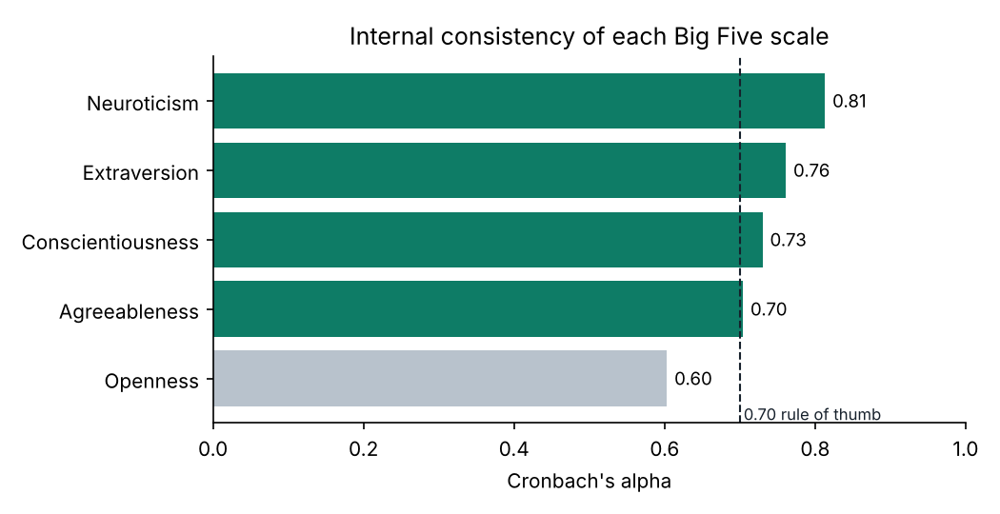
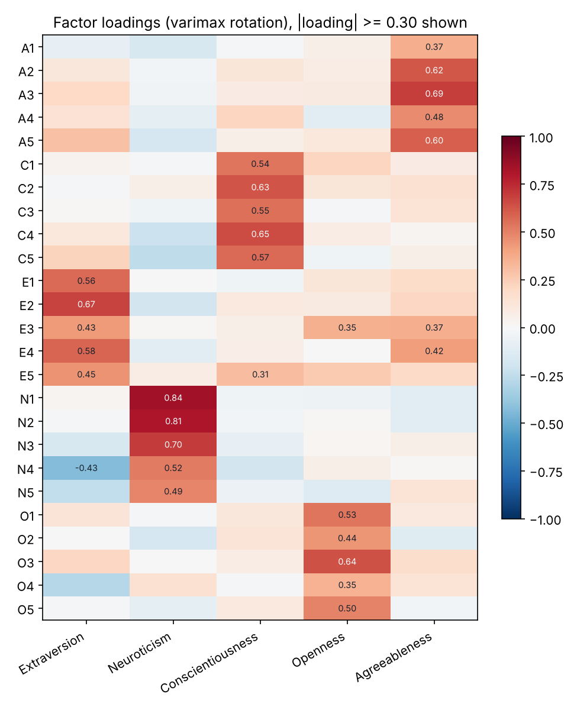
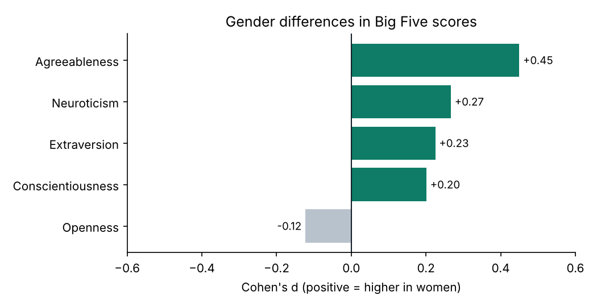

# Big Five Psychometric Report

Data: 2,800 participants from the SAPA project (`psych::bfi`). Removed
2 rows with an implausible age (under 11); kept 2,798.

## 1. Reliability (Cronbach's alpha)

| trait | alpha |
| --- | --- |
| Agreeableness | 0.704 |
| Conscientiousness | 0.73 |
| Extraversion | 0.761 |
| Neuroticism | 0.813 |
| Openness | 0.603 |

Items whose removal would raise their scale's alpha:

| trait | item | item_rest_r | alpha_if_dropped |
| --- | --- | --- | --- |
| Agreeableness | A1 | 0.311 | 0.718 |
| Openness | O4 | 0.22 | 0.614 |

## 2. Factor structure

KMO = 0.849 and Bartlett's test chi2 = 18,145.8 (p < .001) on
2,435 complete cases, so the items are suitable for factor analysis. The first six
eigenvalues are 5.14, 2.75, 2.14, 1.85, 1.55, 1.07: five are above 1.

25 of 25 items load most strongly on their intended trait.

Every item loads on its intended trait.

## 3. Gender differences

Welch t-tests, Holm-corrected. d > 0 means women score higher.

| trait | women | men | d | p_holm |
| --- | --- | --- | --- | --- |
| Agreeableness | 4.783 | 4.387 | 0.45 | < .001 |
| Conscientiousness | 4.329 | 4.138 | 0.201 | < .001 |
| Extraversion | 4.222 | 3.984 | 0.225 | < .001 |
| Neuroticism | 3.264 | 2.947 | 0.267 | < .001 |
| Openness | 4.555 | 4.655 | -0.123 | 0.002 |

## 4. Age

| trait | r | p | n |
| --- | --- | --- | --- |
| Agreeableness | 0.185 | < .001 | 2795 |
| Conscientiousness | 0.117 | < .001 | 2794 |
| Extraversion | 0.064 | < .001 | 2795 |
| Neuroticism | -0.115 | < .001 | 2794 |
| Openness | 0.077 | < .001 | 2794 |
